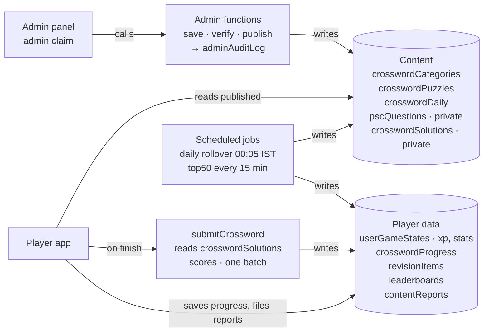
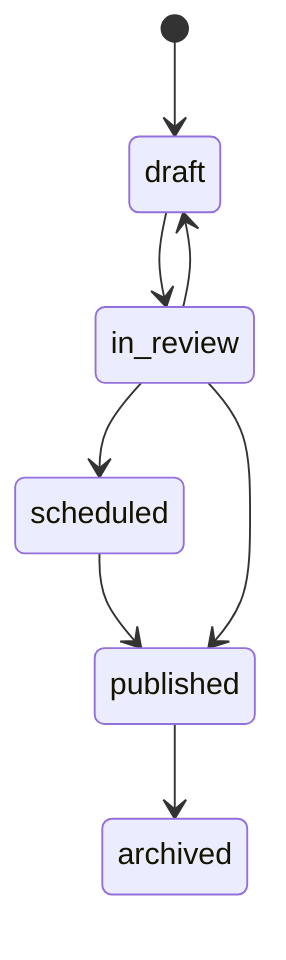

# Firebase Design — PSC Crossword (Phase 1)

> **Status:** Approved for build · **Last updated:** 2026-10-22 · **Tasks:** CW-004 – CW-023 in `TASKS.md`
> Shared doc version: https://claude.ai/artifact/MFySVtYQEnWF5U3QF94bMH

PSC Crossword adds **9 Firestore collections** to the existing WordSchool project. Only admins can create or change content, scores are computed on the server, and the cost is **$0 up to ~2,000 daily players** and **under $5/month at 10,000**.

**Contents:** [Decisions](#decisions) · [Design rules](#design-rules) · [At a glance](#at-a-glance) · [Collections](#collections) · [Flows](#flows) · [Security rules](#security-rules) · [Indexes](#indexes) · [Cloud Functions](#cloud-functions) · [Cost](#cost) · [Later phases](#later-phases)

---

## Decisions

1. **Content is written only by Cloud Functions.** The admin panel calls admin callables (`admin` custom claim → `assertAdmin`); every change goes to `adminAuditLog`. Rules say `allow write: if false` on content.
2. **A question bank sits under puzzles.** Each PSC fact lives once in `pscQuestions`, is verified, then copied into puzzles. Later games reuse it.
3. **One puzzle = one document.** Opening a puzzle costs 1 read. Answers ship **encoded** for offline Check/Reveal; the real key is in private `crosswordSolutions`.
4. **Scores are server-side.** The app saves in-progress letters; finishing goes through `submitCrossword`, which scores, gives XP, updates the leaderboard and saves mistakes in one batch.
5. **Builds on the existing schema.** Players stay in `userGameStates/{uid}`; rules reuse `isOwner`, `isNotBlocked`; admin callables accept `databaseId` like the existing ones (dev = `development`, prod = `(default)` — see DEC-002).

---

## Design rules

Apply these to every future collection too.

| Rule | What it means | Why |
| --- | --- | --- |
| Content is admin-only | App reads content, never writes it. Only functions write. | Players can't tamper; every change is logged |
| Read the way the screen needs it | Each screen loads in 1–3 reads; copy (denormalize) data into the doc the screen reads | Firestore bills per document read |
| Server owns scores | XP, streaks, leaderboard, results written only by functions | No cheating; trustworthy numbers |
| Batch progress saves | Save on pause, on leave, or every 30 s — never per keystroke | Per-keystroke saving = 50–100 writes per puzzle |
| Never hard-delete content | `status: "archived"` | Results and revision items still point to it |
| Bilingual text | Every visible text is `{ "en": "…", "ml": "…" }` | Malayalam later without schema change |
| Version content docs | `schemaVersion: 1` | Handle old + new shapes during upgrades |
| Standard metadata | `createdAt`, `updatedAt` (server time), `createdBy`, `updatedBy` (admin uid) | Debugging and audits |
| Naming | Collections plural camelCase; fields camelCase; enum values `snake_case`; readable IDs | Matches current code; readable in console |
| Dates | Crossword daily keys `YYYY-MM-DD` in **Asia/Kolkata**; weeks ISO (`2026-W43`) | Same puzzle for everyone at Indian midnight (DEC-001) |
| Free tools first | Flags, level formula, min version in **Remote Config** | Saves a read on every app open |

---

## At a glance



| # | Collection | Who writes | App reads? |
| --- | --- | --- | --- |
| 1 | `crosswordCategories/{categoryId}` | Admin functions | Active only |
| 2 | `pscQuestions/{questionId}` | Admin functions | **No** |
| 3 | `crosswordPuzzles/{puzzleId}` | Admin functions | Published only |
| 4 | `crosswordSolutions/{puzzleId}` | Admin functions | **No** |
| 5 | `crosswordDaily/{YYYY-MM-DD}` | Scheduled job / admin | Yes |
| 6 | `userGameStates/{uid}/crosswordProgress/{puzzleId}` | Player (in progress) + `submitCrossword` | Own |
| 7 | `userGameStates/{uid}/revisionItems/{questionId}` | `submitCrossword` (+ player toggles `mastered`) | Own |
| 8 | `leaderboards/{boardId}/entries/{uid}` | `submitCrossword` + scheduled job | Signed-in |
| 9 | `contentReports/{reportId}` | Player (create only) | **No** |

Plus new server-only fields on `userGameStates/{uid}`: `xp`, `crossword`.

---

## Collections

Every content document also has `schemaVersion`, `createdAt`, `updatedAt`, `createdBy`, `updatedBy` (not repeated below).

### 1. `crosswordCategories/{categoryId}` — Home categories

ID = slug (`kerala-history`).

| Field | Type | Example / notes |
| --- | --- | --- |
| `name` | map | `{ "en": "Kerala History", "ml": "കേരള ചരിത്രം" }` |
| `description` | map | Short line under the name |
| `icon` | string | Icon key mapped to an asset, e.g. `landmark` |
| `color` | string | Hex accent, e.g. `#6AAA64` |
| `order` | number | Sort on Home (10, 20, 30…) |
| `isActive` | bool | Hide without deleting |
| `publishedPuzzleCount` | number | Maintained by `adminSetPuzzleStatus` |

### 2. `pscQuestions/{questionId}` — Verified fact bank (private)

Auto ID. Never read by the app.

| Field | Type | Example / notes |
| --- | --- | --- |
| `answer` | string | `VAIKOM` — uppercase A–Z, no spaces |
| `answerDisplay` | map | `{ "en": "Vaikom", "ml": "വൈക്കം" }` |
| `clues` | array<map> | `[{ "en": "1924–25 satyagraha for temple road entry", "level": "medium" }]` |
| `fact` | map | Learn-card text |
| `subject` | string | `kerala_history` |
| `topic` | string | `renaissance` |
| `examTags` | array | `["ldc", "lgs", "degree_level"]` |
| `difficulty` | string | `easy` · `medium` · `hard` |
| `source` | map | `{ "type": "pyq", "ref": "LDC 2017, Q42" }` |
| `status` | string | `draft` → `verified` → `retired` |
| `verifiedBy` / `verifiedAt` | string / timestamp | |
| `usedInPuzzles` | array | Puzzle ids |

### 3. `crosswordPuzzles/{puzzleId}` — One playable puzzle

ID `{categoryId}-{0000}` (`kerala-history-0012`). Typical size 5–10 KB.

| Field | Type | Example / notes |
| --- | --- | --- |
| `categoryId` | string | `kerala-history` |
| `number` | number | `12` |
| `title` | map | `{ "en": "Kerala Renaissance and Trade" }` |
| `difficulty` | string | `easy` · `medium` · `hard` |
| `rows`, `cols` | number | `8`, `8` (max 15) |
| `layout` | string | `rows × cols` chars row by row; `.` letter, `#` block |
| `words` | array<map> | Below |
| `xpReward` | number | `50` |
| `estimatedMinutes` | number | `6` |
| `status` | string | `draft` · `in_review` · `scheduled` · `published` · `archived` |
| `publishAt` | timestamp | For `scheduled` |
| `publishedAt` | timestamp | Set on publish |

Each `words` item:

| Field | Type | Example |
| --- | --- | --- |
| `id` | string | `2D` |
| `number`, `direction` | number, string | `2`, `down` |
| `row`, `col`, `length` | number | `2`, `2`, `6` |
| `clue` | map | `{ "en": "1924–25 satyagraha for the right to use temple roads" }` |
| `extraClue` | map | Free "Show a clue" hint |
| `fact` | map | Copied from the question |
| `answerEnc` | string | See [Answer encoding](#answer-encoding) |
| `questionId` | string | Link to `pscQuestions` |

Full example (admin input form, before encoding): `.claude/skills/crossword-content/examples/kerala-history-0012.puzzle.json`.

#### Answer encoding

```
answerEnc = base64( utf8(answer) XOR utf8(puzzleId + ":" + wordId) )   // key repeated over the answer
```

Obfuscation only. The server re-checks with `crosswordSolutions`. Fixture: `VAIKOM`, `kerala-history-0012`, `2D` → `PSQ7KiMs`.

### 4. `crosswordSolutions/{puzzleId}` — Answer key (private)

`{ "answers": { "1A": "MUZIRIS", "2D": "VAIKOM" } }` — read only by `submitCrossword`.

### 5. `crosswordDaily/{YYYY-MM-DD}` — Today's pointer (IST date)

`puzzleId`, `categoryId`, `title`, `difficulty`, `wordCount`, `xpReward`, `estimatedMinutes`.

### 6. `userGameStates/{uid}/crosswordProgress/{puzzleId}` — Player state

| Field | Type | Notes |
| --- | --- | --- |
| `status` | string | `in_progress` · `completed` |
| `letters` | string | Same length as `layout`; `.` = empty |
| `elapsedSec` | number | Only goes up |
| `hintsUsed` | map | `{ "letter": 1, "word": 0, "clue": 2 }` — only goes up |
| `checksUsed` | number | Only goes up |
| `startedAt`, `updatedAt` | timestamp | |
| `result` | map | Server: `{ score, correctWords, totalWords, xpEarned, timeSec, wrongWordIds[] }` |
| `completedAt` | timestamp | Server |

### 7. `userGameStates/{uid}/revisionItems/{questionId}` — "My mistakes"

Server upserts on every wrong or revealed word. Fields: `answer`, `answerDisplay`, `clue`, `fact`, `subject`, `source` (`{ "game": "crossword", "puzzleId": "…" }`), `wrongCount`, `lastWrongAt`, `mastered` (player may toggle only this), `nextReviewAt` (reserved), `updatedAt`.

### 8. `leaderboards/{boardId}/entries/{uid}` — Weekly ranks

`boardId = {game}-{isoWeek}` → `crossword-2026-W43`. Parent doc: `top50` array + `updatedAt` (refreshed every 15 min). Entry: `displayName`, `photoUrl`, `points`, `puzzlesSolved`, `updatedAt`.

### 9. `contentReports/{reportId}` — "Report a wrong answer"

`uid`, `puzzleId`, `wordId`, `questionId`, `reason` (`wrong_answer` · `typo` · `other`), `message` (≤ 500), `status` (`open` · `fixed` · `rejected`), `createdAt`.

### New fields on `userGameStates/{uid}` (server-only)

- `xp` — total across games. Level is computed in the app from Remote Config `xp_level_formula`, never stored.
- `crossword` — `{ played, solved, currentStreak, longestStreak, lastSolvedDate, bestTimeSec }`.
- `rateLimit` — `{ submitWindowStart, submitCount }` used by `submitCrossword`.

The current rules already stop clients changing fields outside their allowed lists.

---

## Flows

### Admin: fact → live puzzle

1. **Add facts** → `adminSaveQuestion` (`status: draft`).
2. **Verify** → `adminVerifyQuestion` (`verified`, `verifiedBy`). Only verified facts go into puzzles.
3. **Build** → `adminSaveCrosswordPuzzle` validates the grid, saves the puzzle (`draft`) and `crosswordSolutions` in one batch.
4. **Review** → `adminSetPuzzleStatus`: `in_review` → `scheduled` (+ `publishAt`), or publish now.
5. **Go live** → `crosswordDailyRollover` at 00:05 IST publishes due puzzles; `adminScheduleDaily` sets `crosswordDaily/{date}`.
6. **Fix / retire** → edit (audited) or `archived`.



### Player: open and play

1. **Home** reads `crosswordDaily/{today IST}`, active categories (cached), own `userGameStates/{uid}`.
2. **Category list**: published puzzles in the category, `number` desc, 20 per page.
3. **Puzzle**: puzzle doc + own progress doc.
4. **Play**: Check / Reveal / Show clue are offline; progress saved on pause, leave, or every 30 s; paid hints use `hintPackBalance`.

### Player: finish

1. App calls `submitCrossword({ puzzleId, letters, elapsedSec })`.
2. Function reads `crosswordSolutions` + progress; scores each word; XP = `xpReward` − 5 per revealed letter − 15 per revealed word (min 0).
3. One batch: progress `result` + `completed`; `userGameStates.xp` + `crossword` stats; `leaderboards/crossword-{week}/entries/{uid}`; `revisionItems` for wrong/revealed words.
4. Returns the result — the Results screen needs no extra reads.
5. Calling again returns the stored result (idempotent).

---

## Security rules

Extends `firestore.rules`, reusing `isAuthenticated`, `isOwner`, `isNotBlocked`, `isDateId`, `isNonNegativeInt`. Functions use the Admin SDK and bypass rules.

| Collection | App can read | App can write |
| --- | --- | --- |
| `crosswordCategories` | Active only | No |
| `crosswordPuzzles` | Published only | No |
| `crosswordDaily` | Yes | No |
| `pscQuestions`, `crosswordSolutions` | No | No |
| `crosswordProgress` (own) | Yes | Create/update while `in_progress`; values only go up |
| `revisionItems` (own) | Yes | Only `mastered` |
| `leaderboards` | Signed-in | No |
| `contentReports` | No | Create only |

**1. Helpers** (add to the `Helpers` block):

```js
function isHintCount(h) {
  return h is map
    && h.keys().hasAll(['letter', 'word', 'clue'])
    && h.keys().hasOnly(['letter', 'word', 'clue'])
    && isNonNegativeInt(h.letter)
    && isNonNegativeInt(h.word)
    && isNonNegativeInt(h.clue);
}
function isCrosswordProgress(d) {
  return d.status == 'in_progress'
    && d.letters is string && d.letters.size() <= 400
    && isNonNegativeInt(d.elapsedSec)
    && isNonNegativeInt(d.checksUsed)
    && isHintCount(d.hintsUsed)
    && d.updatedAt == request.time;
}
```

**2. Inside `match /userGameStates/{uid} { … }`:**

```js
match /crosswordProgress/{puzzleId} {
  allow read: if isOwner(uid);

  allow create: if isOwner(uid) && isNotBlocked(uid)
    && request.resource.data.keys().hasOnly(['status', 'letters', 'elapsedSec',
         'hintsUsed', 'checksUsed', 'startedAt', 'updatedAt'])
    && isCrosswordProgress(request.resource.data)
    && request.resource.data.startedAt == request.time
    && get(/databases/$(database)/documents/crosswordPuzzles/$(puzzleId)).data.status == 'published';

  allow update: if isOwner(uid) && isNotBlocked(uid)
    && resource.data.status == 'in_progress'
    && request.resource.data.diff(resource.data).affectedKeys()
         .hasOnly(['letters', 'elapsedSec', 'hintsUsed', 'checksUsed', 'updatedAt'])
    && isCrosswordProgress(request.resource.data)
    && request.resource.data.letters.size() == resource.data.letters.size()
    && request.resource.data.elapsedSec >= resource.data.elapsedSec
    && request.resource.data.checksUsed >= resource.data.checksUsed
    && request.resource.data.hintsUsed.letter >= resource.data.hintsUsed.letter
    && request.resource.data.hintsUsed.word >= resource.data.hintsUsed.word
    && request.resource.data.hintsUsed.clue >= resource.data.hintsUsed.clue;

  allow delete: if false;
}

match /revisionItems/{questionId} {
  allow read: if isOwner(uid);
  allow update: if isOwner(uid) && isNotBlocked(uid)
    && request.resource.data.diff(resource.data).affectedKeys().hasOnly(['mastered', 'updatedAt'])
    && request.resource.data.mastered is bool
    && request.resource.data.updatedAt == request.time;
  allow create, delete: if false;
}
```

**3. Top level, above the catch-all deny:**

```js
// ---------- PSC Crossword content (written only by Cloud Functions) ----------
match /crosswordCategories/{categoryId} {
  allow read: if resource.data.isActive == true;
  allow write: if false;
}
match /crosswordPuzzles/{puzzleId} {
  allow read: if resource.data.status == 'published';
  allow write: if false;
}
match /crosswordDaily/{dateId} {
  allow read: if isDateId(dateId);
  allow write: if false;
}

// ---------- Private ----------
match /pscQuestions/{questionId} {
  allow read, write: if false;
}
match /crosswordSolutions/{puzzleId} {
  allow read, write: if false;
}

// ---------- Weekly leaderboards (server-written) ----------
match /leaderboards/{boardId} {
  allow read: if isAuthenticated();
  allow write: if false;
  match /entries/{userId} {
    allow read: if isAuthenticated();
    allow write: if false;
  }
}

// ---------- Player reports: create only ----------
match /contentReports/{reportId} {
  allow create: if isAuthenticated() && isNotBlocked(request.auth.uid)
    && request.resource.data.keys().hasOnly(['uid', 'puzzleId', 'wordId',
         'questionId', 'reason', 'message', 'status', 'createdAt'])
    && request.resource.data.uid == request.auth.uid
    && request.resource.data.reason in ['wrong_answer', 'typo', 'other']
    && request.resource.data.message is string
    && request.resource.data.message.size() <= 500
    && request.resource.data.status == 'open'
    && request.resource.data.createdAt == request.time;
  allow read, update, delete: if false;
}
```

> Rules are not filters: queries must include `where('isActive', isEqualTo: true)` (categories) and `where('status', isEqualTo: 'published')` (puzzles).

---

## Indexes

Merge into `firestore.indexes.json`:

```json
{
  "indexes": [
    {
      "collectionGroup": "crosswordPuzzles",
      "queryScope": "COLLECTION",
      "fields": [
        { "fieldPath": "categoryId", "order": "ASCENDING" },
        { "fieldPath": "status", "order": "ASCENDING" },
        { "fieldPath": "number", "order": "DESCENDING" }
      ]
    },
    {
      "collectionGroup": "revisionItems",
      "queryScope": "COLLECTION",
      "fields": [
        { "fieldPath": "mastered", "order": "ASCENDING" },
        { "fieldPath": "lastWrongAt", "order": "DESCENDING" }
      ]
    },
    {
      "collectionGroup": "pscQuestions",
      "queryScope": "COLLECTION",
      "fields": [
        { "fieldPath": "subject", "order": "ASCENDING" },
        { "fieldPath": "status", "order": "ASCENDING" },
        { "fieldPath": "updatedAt", "order": "DESCENDING" }
      ]
    }
  ],
  "fieldOverrides": [
    { "collectionGroup": "crosswordPuzzles", "fieldPath": "words", "indexes": [] },
    { "collectionGroup": "crosswordProgress", "fieldPath": "letters", "indexes": [] }
  ]
}
```

Leaderboard `orderBy('points', 'desc')` and rank `where('points', '>', mine).count()` use automatic single-field indexes.

---

## Cloud Functions

In `functions/src/crossword/`, region `asia-south1`. Admin callables: `assertAdmin` → `parseDatabaseId` → `dbForDatabaseId` → … → `writeAuditLog`.

| Function | Type | Caller | Does |
| --- | --- | --- | --- |
| `adminSaveCategory` | Callable | Admin | Create/edit category |
| `adminSaveQuestion` | Callable | Admin | Create/edit fact; answer A–Z; edit of verified → draft |
| `adminVerifyQuestion` | Callable | Admin | `draft → verified` |
| `adminSaveCrosswordPuzzle` | Callable | Admin | Validate grid; save puzzle + solution in one batch; encode answers |
| `adminSetPuzzleStatus` | Callable | Admin | Status state machine; category count |
| `adminScheduleDaily` | Callable | Admin | Set daily puzzle for a date |
| `adminListReports` / `adminResolveReport` | Callable | Admin | Review player reports |
| `submitCrossword` | Callable | Player | Score; one batch: result, XP, stats, leaderboard, revision |
| `crosswordDailyRollover` | Scheduled 00:05 IST | System | Publish due puzzles; warn if tomorrow is empty |
| `refreshLeaderboardTop` | Scheduled 15 min | System | Copy top 50 into parent doc |

`submitCrossword` also rejects impossible results (`elapsedSec < wordCount × 2`) and allows 30 calls/hour/player (`rateLimit` on the user doc).

---

## Cost

**$0 up to ~2,000 daily players; ≈ $3/month at 10,000; ≈ $20/month at 50,000** — assuming one puzzle per player per day.

Per player per day ≈ **20 reads** (Home 3, list ≤ 10, puzzle 2, results/ranks 3, revision 2) and **9 writes** (4 progress saves + submit batch of 5). Leaderboard refresh adds 4,800 reads/day total.

| Daily players | Reads / day | Writes / day | Firestore / month |
| --- | --- | --- | --- |
| 1,000 | 25,000 | 9,000 | $0 |
| 2,000 | 45,000 | 18,000 | $0 |
| 10,000 | 205,000 | 90,000 | ≈ $3.30 |
| 50,000 | 1,005,000 | 450,000 | ≈ $20 |

Firestore Standard: free 50,000 reads, 20,000 writes, 1 GiB per day on the `(default)` database; then $0.03 / 100k reads and $0.09 / 100k writes ([pricing](https://cloud.google.com/firestore/pricing), checked 2026-10-22). **Named databases (like `development`) get no free quota** — fine for dev traffic, never for prod. Functions stay inside 2M free invocations/month even at 50,000 players.

**Keep it low:** no list listeners · offline cache on · paginate at 20 · read `top50` not entries · batch progress saves · App Check on Firestore + Functions · budget alerts at $10 and $25.

---

## Later phases

| Shared piece | Phase 1 | Later |
| --- | --- | --- |
| `pscQuestions` | Crossword words | Clue Wordle, Map Challenge facts (`geo` fields), quizzes |
| `userGameStates.xp` | Crossword XP | One XP/level across games |
| `revisionItems` | Crossword mistakes | Every game (`source.game`) |
| `leaderboards/{game}-{week}` | `crossword-…` | `map-…`, overall `xp-…` |
| `contentReports` | Crossword | Any game (`game` field) |
| Admin callable + audit pattern | Crossword | Every content type |

**Kerala Map Challenge:** `mapChallenges/{challengeId}` (routes, landmarks, district sets as coordinates), `userGameStates/{uid}/mapProgress/{challengeId}`, `submitMapChallenge` (server-side route accuracy). Map shapes ship as app assets, not Firestore docs.
